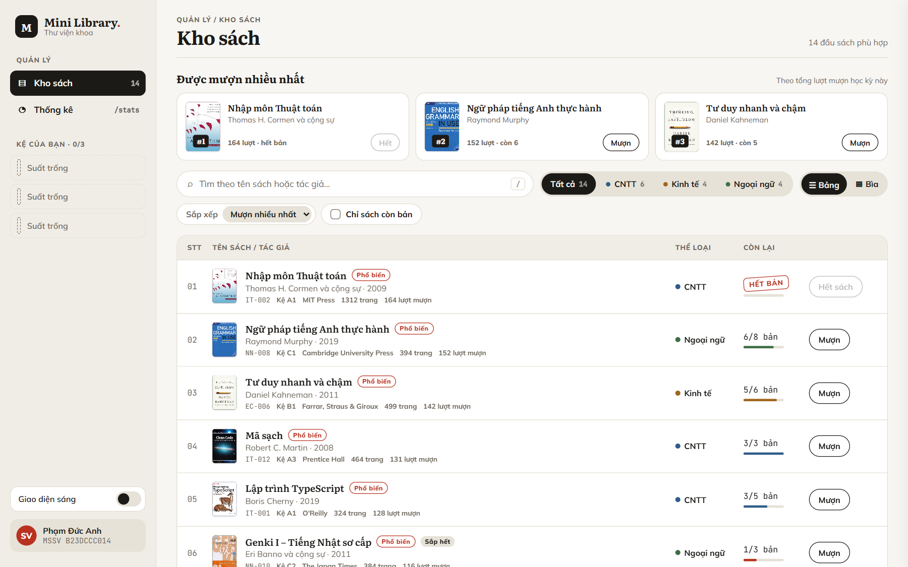
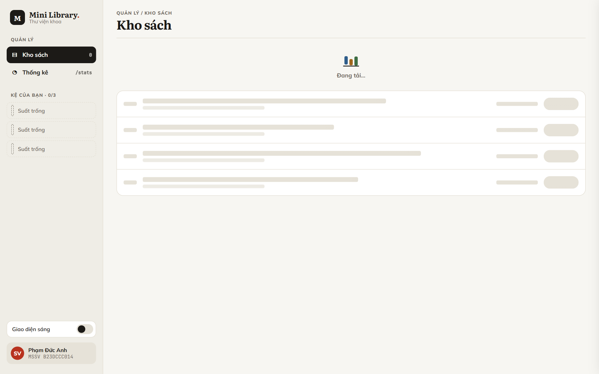
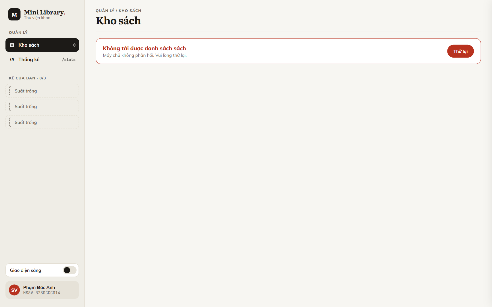
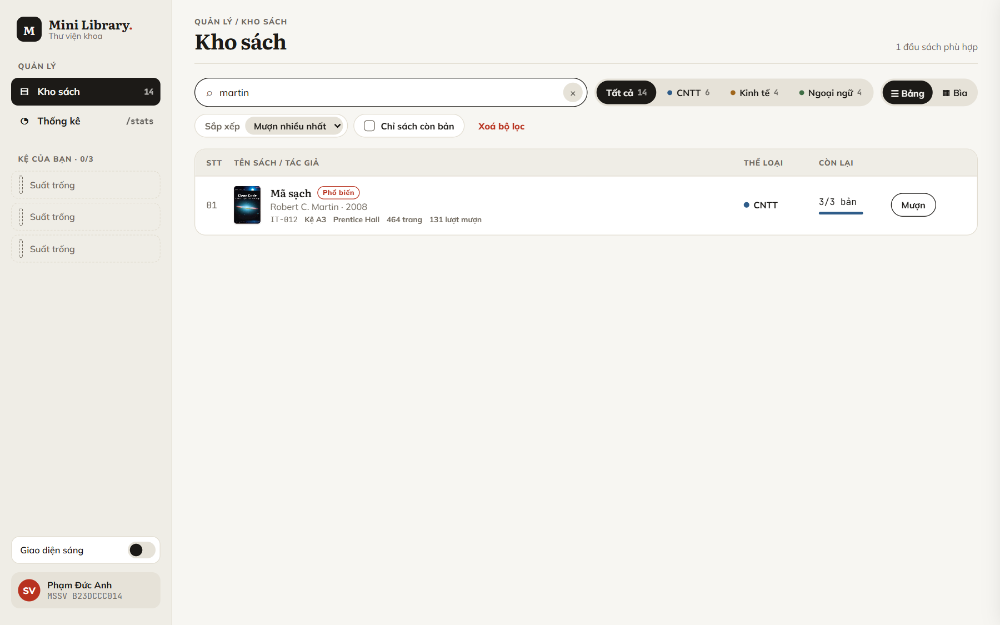
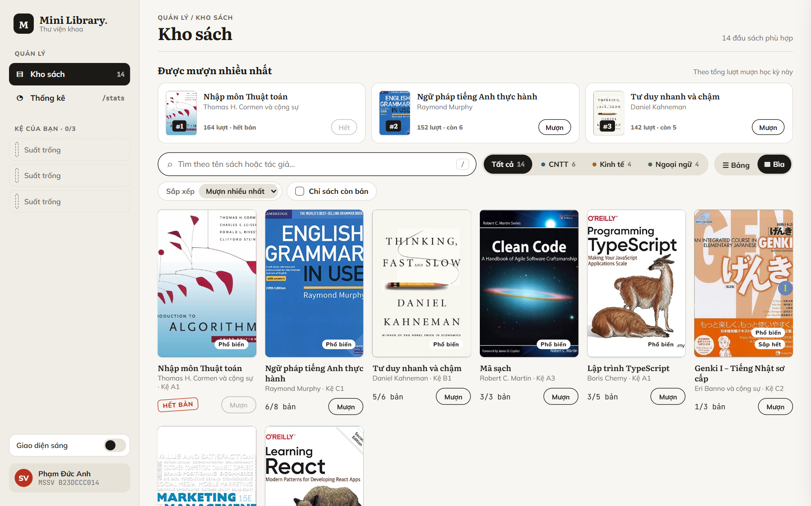
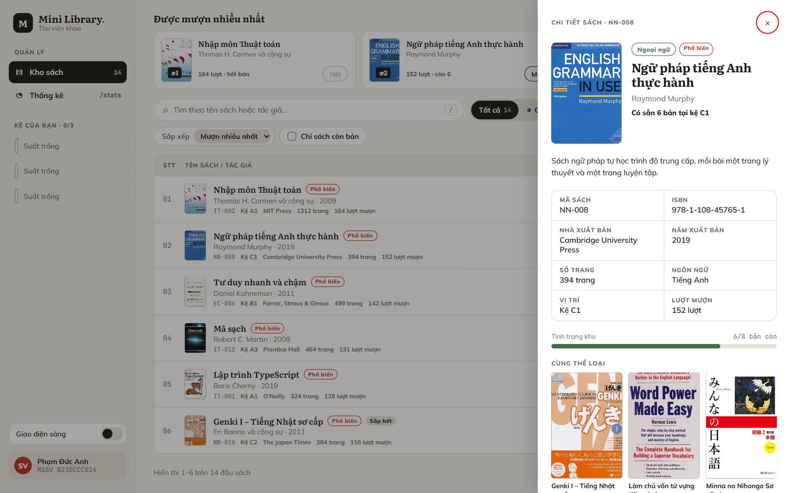
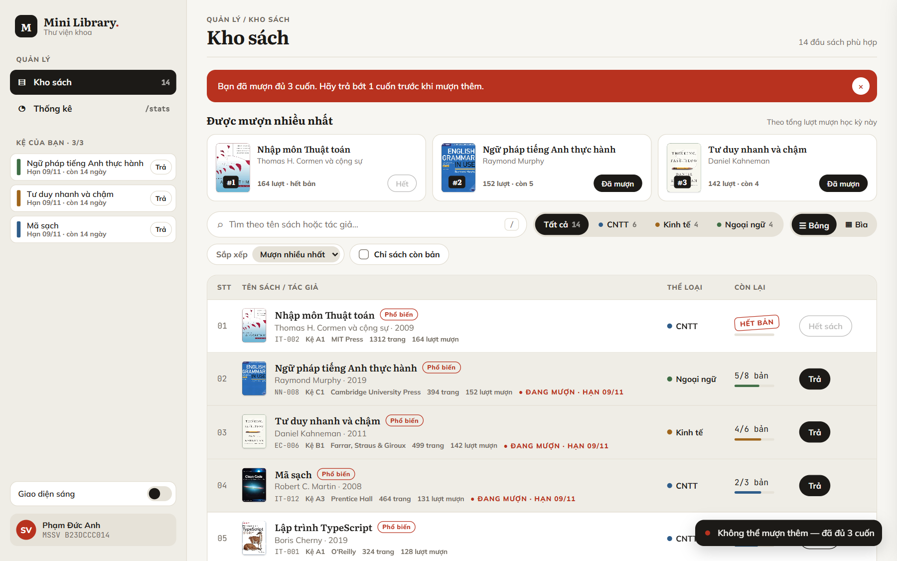
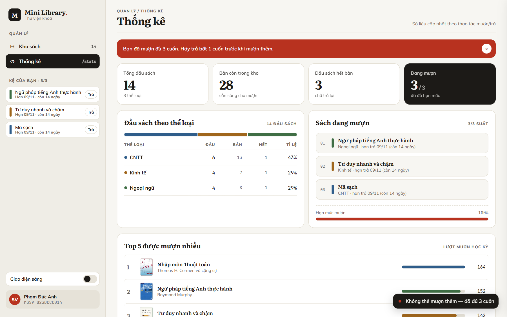
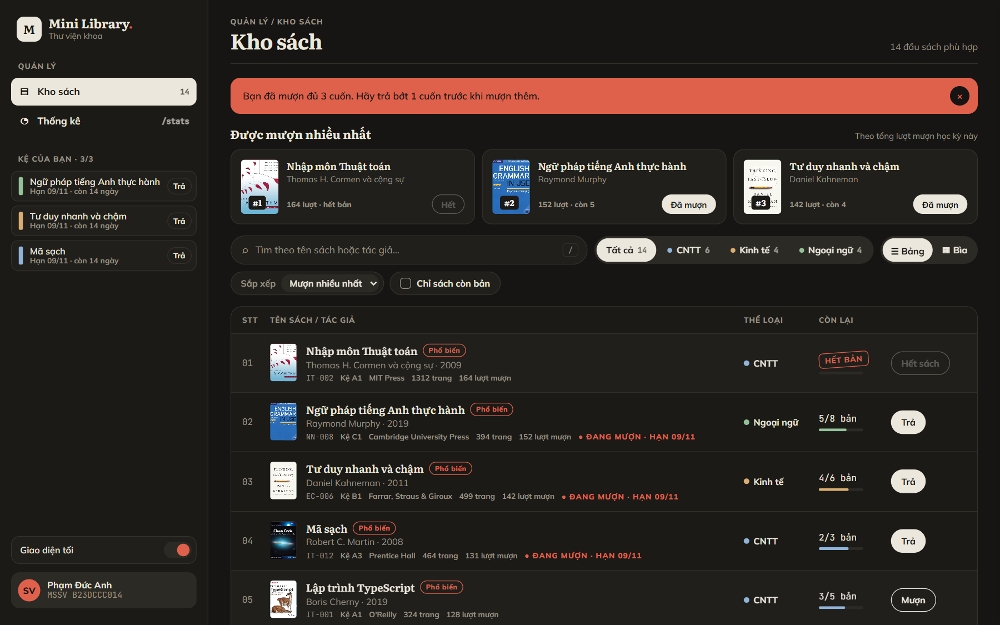

# Mini Library

Ứng dụng tra cứu, mượn và trả sách (LTWNC – kiểm tra giữa kỳ). React 19 + TypeScript + Vite, Redux Toolkit, Zustand, React Context.

Dữ liệu là fake API trong `src/api/booksApi.ts` (Promise + `setTimeout` 500ms), không gọi backend.



## Chạy

```bash
npm install
npm run dev      # http://localhost:5173
npm run build    # tsc -b + vite build, có chunk riêng cho StatsPage
```

Jest + React Testing Library đã được cấu hình (`jest.config.cjs`), nhưng repo chưa có file test nào.

## Tính năng

- Danh sách sách dạng Bảng hoặc Bìa, phân trang 6 (Bảng) / 8 (Bìa) mục mỗi trang.
- Tìm kiếm không phân biệt hoa thường (debounce 300ms), lọc theo thể loại, "Chỉ sách còn bản", 4 kiểu sắp xếp.
- Mượn / trả với loading riêng từng cuốn; tối đa 3 cuốn (chặn bằng middleware tự viết), hạn trả = ngày mượn + 14 ngày.
- Bấm vào một dòng hoặc thẻ để mở drawer chi tiết (`Esc` để đóng, focus được giữ trong drawer).
- Đổi giao diện sáng / tối (Context, lưu lại sau khi tải trang).
- `/stats`: thống kê, lazy load bằng `React.lazy` + `Suspense`.

## Giao diện

### 1. Kho sách


### 2. Trạng thái tải và lỗi

Mở `/` thấy skeleton và "Đang tải...". Mở `/?fail=1` để demo lỗi: API trả `{ ok: false, error }`, màn hình báo lỗi kèm nút **Thử lại**.

| Đang tải | Lỗi (`/?fail=1`) |
|---|---|
|  |  |

### 3. Tìm kiếm

Gõ "martin" (không phân biệt hoa thường, debounce 300ms) chỉ còn "Mã sạch".



### 4. Kiểu Bìa



### 5. Chi tiết sách

Bấm vào bất kỳ chỗ nào của dòng hoặc thẻ để mở drawer chi tiết.



### 6. Giới hạn mượn 3 cuốn

Mượn cuốn thứ 4 bị middleware chặn: số bản không đổi, hiện banner cảnh báo và toast.



### 7. Thống kê (`/stats`, lazy load)



### 8. Giao diện tối



## Cấu trúc thư mục

```
src/
  api/booksApi.ts              fake API (getBooks, borrowBookApi, returnBookApi)
  types/book.ts                Book, ApiResult<T>, type guard, utility types
  app/                         store.ts, hooks.ts (typed hooks)
  hooks/                       useDebounce<T>, usePagination, useNow
  constants/                   hằng số và thông báo
  features/
    books/                     booksSlice, borrowLimitMiddleware, selectors, components/, hooks/
    filters/                   filterStore (Zustand), sorting
    theme/                     ThemeContext, useTheme, ThemeToggle
    toast/, ui/                toast và state giao diện (Zustand)
    stats/StatsPage.tsx        trang /stats (lazy)
  layout/Sidebar.tsx
  pages/HomePage.tsx
  shared/                      createSafeContext, formatDate, components dùng chung
  styles/                      CSS chia 21 file, gộp bằng index.css
docs/screenshots/              ảnh minh chứng giao diện
```
